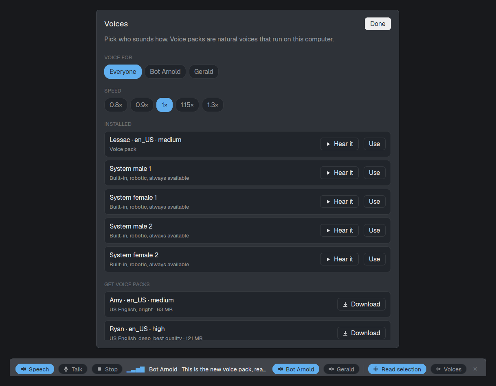

# herdr-speech

Talk to your coding agents in [Herdr](https://herdr.dev) and hear them answer.

- **Hear replies.** When a Claude Code agent finishes a turn, its reply is read aloud, one sentence at a time, with the sentence shown in a banner.
- **Short and to the point.** Long replies are summarized by Claude Haiku into a few spoken sentences: the outcome first, plus anything you need to decide. **Read all** reads the whole reply.
- **Talk back.** Press **Talk**, say your prompt and press **Send**. Your words are turned into text on your own computer and typed into the agent you're looking at.
- **Read terminal text.** Turn on **Read selection** and text you highlight or copy in Herdr's terminals is read aloud.
- **Pick voices.** Natural-sounding [Piper](https://github.com/OHF-Voice/piper1-gpl) voice packs, a different voice per agent, and a speed setting.

Voices, speech-to-text and selection reading run on your own computer. Only the summaries use the network: they go through your Claude Code login to Claude Haiku, the same service your agent already uses. Switch **Summaries** off to keep everything local.



## Requirements

- Linux with PipeWire or PulseAudio, and Herdr installed and started once.
- Python 3.9 or newer. The installer uses [uv](https://docs.astral.sh/uv/) when it's installed, else `python3 -m venv`.
- Optional:
  - `speech-dispatcher` (`spd-say`) for the built-in robotic voices, and as a fallback when Herdr isn't running.
  - `python3-gi` and `gir1.2-gtk-3.0` for **Read selection**. Most GNOME desktops already have them.

On Ubuntu or Debian:

```sh
sudo apt install speech-dispatcher python3-venv python3-gi gir1.2-gtk-3.0
```

## Install

```sh
git clone https://github.com/RoverWillemars/herdr-speech.git
cd herdr-speech
./install.sh --claude-hooks
```

This:

1. copies the `speech` and `speech-voices` mods into `~/.config/herdr-app/mods/`;
2. puts the helper scripts, a Python environment, voice packs and the speech-to-text model in `~/.local/share/herdr-speech/` (about 700 MB in all, mostly the Python libraries);
3. downloads one voice pack (`en_US-lessac-medium`, 63 MB) and the Whisper `base` speech-to-text model (about 145 MB);
4. with `--claude-hooks`, adds two hooks to `~/.claude/settings.json` so that Claude Code replies are read aloud;
5. opens the banner in Herdr.

After installing, open `/hooks` once in Claude Code sessions that were already running (or restart them) so they load the hooks.

Installer options:

| Option | What it does |
|---|---|
| `--claude-hooks` | Add the read-aloud hooks to `~/.claude/settings.json`. |
| `--voice NAME` | Install another voice pack first, e.g. `en_GB-alba-medium`. |
| `--no-voice` | Skip the voice pack; the robotic system voice is used. |
| `--no-mic` | Skip speech-to-text; the Talk button won't work. |
| `--uninstall` | Remove the mods and `~/.local/share/herdr-speech`. |

Run `./install.sh` again to update after a `git pull`.

### Only for one project

To use the hooks in one project instead of in every Claude Code session, skip `--claude-hooks` and put this in that project's `.claude/settings.local.json`:

```json
{
  "hooks": {
    "Stop": [{ "hooks": [{ "type": "command", "command": "~/.local/share/herdr-speech/bin/speak-reply.py 2>/dev/null || true", "async": true }] }],
    "UserPromptSubmit": [{ "hooks": [{ "type": "command", "command": "~/.local/share/herdr-speech/bin/speak-reply.py --stop 2>/dev/null || true" }] }]
  }
}
```

## Using it

The banner is a floating window: drag it anywhere and it stays there, also after a restart. From left to right:

| Control | What it does |
|---|---|
| **Speech / Muted** | Mutes all speech. Unmuting continues the reply from the sentence that was cut off. |
| **Talk / Send** | Starts listening. Press **Send** when you're done and your words go to the agent you're looking at, or else the last one that spoke. **Cancel** throws the recording away. |
| **Stop** | Stops the reply being read. |
| **Read all** | After a summary: reads the whole reply instead. |
| The middle | Who is speaking and the sentence being read; while you talk, who you're talking to. |
| One button per agent | Lit: that agent's replies are read aloud. Turning one off mid-reply pauses it; turning it on again continues. |
| **Read selection** | While on, text you highlight or copy in a terminal of the shown Herdr tab is read aloud. Other apps, and Herdr's side panels, are ignored. Text that looks like a password is skipped (see [Privacy and security](#privacy-and-security)). |
| **Summaries / Full replies** | Summaries (the default): replies longer than about 400 characters are summarized first, which takes a few seconds ("Summarizing the reply…"). Full replies: everything is read as written. |
| **Voices** | Pick a voice for everyone or per agent, set the speed, preview voices and download voice packs. |
| **✕** | Closes the banner. Reopen it with `herdr-app do mod.open --name speech`. |

Sending a new prompt to an agent stops that agent's speech, so you can interrupt by talking or typing.

### Keyboard shortcuts

The banner listens for `speech.talk`, `speech.stop`, `speech.mute`, `speech.select`, `speech.full` (Read all) and `speech.summary` (switch Summaries / Full replies). To bind them, add them to `~/.config/herdr-app/keys.json`, for example:

```json
{ "global": { "ctrl-alt-t": "speech.talk", "ctrl-alt-s": "speech.stop", "ctrl-alt-m": "speech.mute" } }
```

Herdr only sends these to the banner while it's open.

## Voice packs

A voice pack is a [Piper](https://github.com/OHF-Voice/piper1-gpl) voice: a `NAME.onnx` model with its `NAME.onnx.json` next to it, in `~/.local/share/herdr-speech/voices/`. Packs show up in **Voices** by themselves.

- **From the dialog:** **Voices → Get voice packs** has a short list of good ones.
- **Any voice from the catalog:** hear samples at [rhasspy.github.io/piper-samples](https://rhasspy.github.io/piper-samples/), then:

  ```sh
  ~/.local/share/herdr-speech/bin/get-voice.py --list nl_        # names, filtered
  ~/.local/share/herdr-speech/bin/get-voice.py nl_NL-ronnie-medium
  ```

- **Your own:** copy any Piper `.onnx` + `.onnx.json` pair into the voices folder.

`low` and `medium` packs are about 60 MB and fast; `high` packs sound better and take about twice the space.

## Settings

The helpers read these environment variables. Set them where Herdr starts (for example in `~/.profile`), since the banner runs the helpers.

| Variable | Default | What it does |
|---|---|---|
| `HERDR_SPEECH_MIC` | first input that isn't a speaker monitor | Microphone to record from. List them with `pactl list short sources`. |
| `HERDR_SPEECH_STT_MODEL` | `base` | Whisper model: `tiny`, `base`, `small`, `medium`, or an English-only one such as `base.en`. Bigger ones are more accurate and slower. Run `listen.py warmup` after changing it. |
| `HERDR_SPEECH_LANGUAGE` | detected | The language you speak, e.g. `en` or `nl`. Setting it helps with short prompts. |
| `HERDR_SPEECH_HOME` | `~/.local/share/herdr-speech` | Where the helpers and data live. The installer and the hook honor it; the mods expect the default. |
| `HERDR_SPEECH_SUMMARY_MODEL` | `haiku` | The Claude model that writes summaries. |
| `CLAUDE_BIN` | `claude` on your PATH | The Claude Code command used for summaries. |
| `SPEAK_MAX_CHARS` | `6000` | The longest reply passed on for reading; longer replies are cut off. Without the banner, replies are cut at 1500. |

## How it works

```
Claude Code  ──Stop hook──▶  speak-reply.py ──▶ spool/<terminal>.json ──▶ speech mod (banner)
                                                                              │
                         state/now.json (which sentence) ◀── say.py ◀─────────┘ Piper or spd-say
speech mod ──Talk──▶ listen.py (pw-record + faster-whisper) ──▶ hc send <agent> "<your words>"
```

- `bin/speak-reply.py` (the Claude Code hook) strips markdown from the reply and hands it to the banner. When the banner isn't running, it speaks through `spd-say` itself.
- `mods/speech` is the banner. It queues replies, keeps track of mute and per-agent buttons, and runs `say.py` for one reply at a time.
- `bin/summarize.py` runs `claude -p --model haiku` with hooks, tools and session saving off, so a summary is one small call and doesn't start another read-aloud. If it fails, the banner reads the first two sentences instead.
- `bin/say.py` turns sentences into speech with Piper, preparing the next sentence while the current one plays, or with `spd-say`.
- `bin/listen.py` records the microphone with `pw-record` (or `parecord`) and transcribes it with faster-whisper.
- `bin/clipread.py` reads the highlighted text and the clipboard through GTK. The banner only reads it aloud when Herdr's window is active and `hc read` finds the text in a terminal of the shown tab.
- `mods/speech-voices` is the Voices dialog. It stores choices in Herdr's shared state (`speech.voices`, `speech.speed`).

## Troubleshooting

- **No sound:** run `spd-say hello`, then `~/.local/share/herdr-speech/bin/say.py --preview piper:en_US-lessac-medium` (run it with `~/.local/share/herdr-speech/venv/bin/python`).
- **Summaries never come, or always fall back to the first sentences:** run `~/.local/share/herdr-speech/bin/summarize.py "some text"` to see the error. It needs Claude Code to be logged in.
- **Replies aren't read:** check `/hooks` in Claude Code shows the `speak-reply.py` hooks, and that the agent's button is lit in the banner.
- **"No microphone is connected":** no input has a plugged-in microphone. Sound cards list their mic jacks even when they're empty, and those are skipped. Plug in a microphone or headset, or set `HERDR_SPEECH_MIC`.
- **Talk hears nothing or the wrong thing:** set `HERDR_SPEECH_MIC` to your microphone; the default input can be a speaker monitor. Each recording is logged in `~/.local/share/herdr-speech/state/talk.log`.
- **The banner says "Run install.sh":** the Python environment is missing. Run `./install.sh` again.
- **Errors in the banner itself:** `herdr-app status` lists mod errors.

Only Claude Code has a reply hook today. Talk and Read selection work with any agent in Herdr.

## Privacy and security

- **What stays on your computer:** voices, speech-to-text and selection reading. Audio never leaves your machine.
- **What goes over the network:**
  - **Summaries:** the text of long replies goes to Claude Haiku through your Claude Code login. Switch **Summaries** off to keep reply text local.
  - **One-time downloads:** voice packs (from the Piper catalog on Hugging Face, checked against the catalog's checksums) and the Whisper model.
- **What's saved, and where:** replies waiting to be read, the current recording and the last 100 transcripts (`state/talk.log`). They're in `~/.local/share/herdr-speech`, readable by your user only.
- **Read selection only reads Herdr's terminals.** Herdr's window must be active, and the text must be on the screen, or in the last 300 lines, of a terminal in the shown tab. Selections and copies in other apps are never read. It also skips text that looks like a password, token or key: one "word" mixing letter cases, digits or symbols, or common token prefixes. It can't recognize every secret, so switch it off when you handle secrets in a terminal.
- **Talk types into your agent and presses Enter.** If an agent may act without asking (an auto or bypass permission mode), a misheard prompt runs too. Check the banner's "You → …" line.
- **What the installer changes:** it only writes to `~/.config/herdr-app/mods/{speech,speech-voices}` and `~/.local/share/herdr-speech`, plus `~/.claude/settings.json` with `--claude-hooks`, after a backup to `settings.json.bak-herdr-speech`. Python packages are pinned to tested versions.

Found a security problem? Please open a private security advisory on GitHub instead of a public issue.

## License

MIT, see [LICENSE](LICENSE). Piper voice packs have their own licenses; see each voice's `MODEL_CARD` in the [piper-voices](https://huggingface.co/rhasspy/piper-voices) repository.
