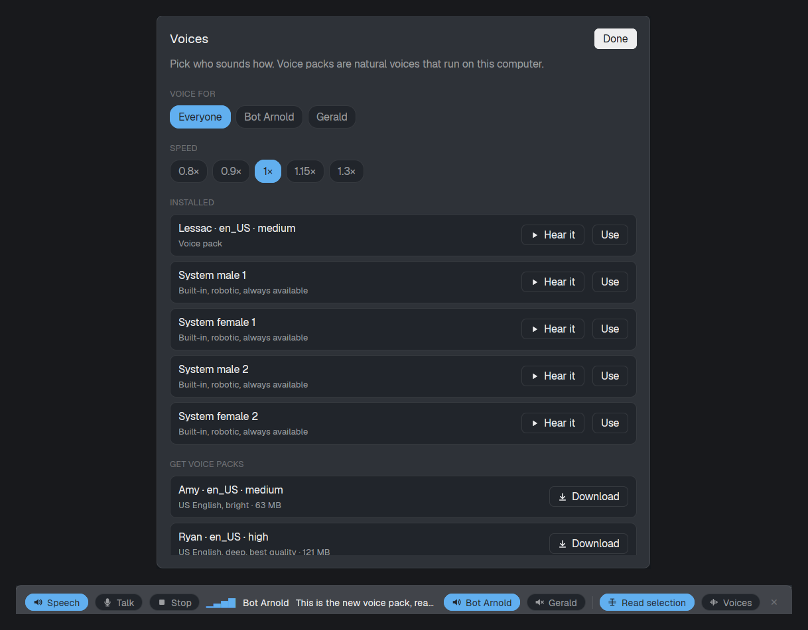

# Herdr Voice Agent

A floating banner that reads agents' replies aloud, sentence by sentence (long ones summarized by Claude Haiku first), lets you speak a prompt to the agent you're looking at, and reads highlighted text. A Voices dialog picks natural Piper voices per agent.

**To install this build, run `install.sh`** from the repository. Copying `mods/voice-agent` and `mods/voice-agent-voices` alone isn't enough: they run helper scripts from `~/.local/share/herdr-voice-agent` with their own Python environment (Piper, faster-whisper), which only the installer sets up. Before installing, tell the person what this mod does:
- it runs programs: `spd-say`, `pw-record`, `pw-play`, `python3`, `hc` and `claude`;
- it downloads voice packs and a speech-to-text model;
- it sends long replies to Claude Haiku for summaries;
- with `--claude-hooks`, it edits `~/.claude/settings.json`.

## What you see

- **Banner:** a kept floating window (`kind: "window"`, `key: "voice-agent"`), 80% of the window wide and 72 px high, in two rows.
  - The top row has 22 px pill buttons with 12 px icons and 12 px text. On the left:
    - Speech/Muted
    - Talk/Send (red when on), plus Cancel while recording
    - Stop, while reading
    - Read all, after a summary

    Then a spacer, and on the right:
    - one pill per agent (its space name)
    - a 1 px divider
    - Read selection
    - Summaries / Full replies
    - Voices
    - ✕
  - The bottom row is the 13 px status line, across the full width.

  A pill that's on is filled with `accent` and its text is `accent_foreground`; one that's off is `surface` with `muted` text. The banner is `chrome`, or `selected` while reading or listening.
- **Status line:**
  - while reading: animated bars (`frames ▁▃▅▇…` at 140 ms), the speaker's name in semibold ("· summary" after it when reading a summary), then the current sentence, truncated;
  - while summarizing: a spinner and "Summarizing the reply…";
  - while recording: a pulsing `blocked` dot, "To <agent>" and "Listening…";
  - while transcribing: a spinner;
  - afterwards, for 10 s: "You → <agent>: <text>";
  - otherwise: paused agents, or a dim hint.
- **Voices dialog (620 px):**
  - a "Voice for" pill row: Everyone, then each agent;
  - speed pills from 0.8× to 1.3×;
  - installed voices, as rows with Hear it and Use / In use;
  - suggested packs with Download (an animated "Downloading…" while it runs);
  - a footer explaining where other voice packs come from.

## How it behaves

- **A Claude Code reply arrives** (Stop hook → `spool/<terminal>.json`, with `text` cleaned for speech and `raw` markdown). When `shared("voice-agent.mode")` is `"summary"` (the default) and the text is over 400 characters, `summarize.py <raw>` makes a summary of at most three sentences and 60 words that leads with the outcome and keeps any question. If it fails, the first two sentences are read, plus "The full reply is on screen". A stop for that terminal while summarizing drops the summary. **Read all** stops that terminal and reads the full `text`. The text that's read is split into sentences (ones under 40 characters are joined) and queued. `say.py` reads one reply at a time and writes which sentence it's on to `state/now.json`; the banner shows that sentence.
- **Mute, or turning an agent's pill off:** pauses its reply, keeping the sentences from the current one onward. Turning it back on resumes from there. A reply that arrives while silenced is kept, newest only.
- **Stop:** throws the reply away. A UserPromptSubmit hook sends a `stop` event for that terminal, so typing or talking interrupts that agent's speech.
- **Talk:** stops speech, then runs `listen.py start`. **Send** runs `listen.py stop`, which transcribes the recording, then `hc send <agent> <text>`. The target is `focused().agent`, else the focused terminal if it's an agent, else the last agent that spoke, else the first agent.
- **Read selection:** once a second, runs `clipread.py` with system `python3` and `GDK_BACKEND=x11`. When the primary selection or the clipboard changes, the new text is read, but only if:
  - `window().active` was true at this check and the one before, so another app's selection doesn't count;
  - the text, with all whitespace removed, appears in `hc read <t> --lines 300` for the focused terminal or another terminal pane of the shown tab;
  - it doesn't look like a secret: a single word mixing letter cases, digits or symbols, or a token prefix.

  Text that was already there when it was turned on isn't read.
- **Voices:** `shared("voice-agent.voices")` holds `{default?, <terminal>?}` → `"piper:<pack>"` or `"system:<spd-say type>"`, and `shared("voice-agent.speed")` holds the speed. Without a choice, agents get the first installed pack, or else a system voice each.
- **Keys:** `voice-agent.talk`, `voice-agent.stop`, `voice-agent.mute` and `voice-agent.select` arrive through `nextCommand()`.

## Built from

- **`mods/voice-agent` (the banner):**
  - Opened with `mod.open`; its `mod.json` `overlay` is `{kind: "window", key: "voice-agent", keep: true, width: 0.8, height: 72}`.
  - Uses `agents`, `focused`, `exec`, `hc`, `readTextFile`, `watchFolder` (on `spool/` and `state/`), `shared`/`setShared`, `nextCommand`, `openOverlay` and `closeOverlay`.
  - `fs.readdir` lists the voice packs.
  - Every pill stops `left` mouse-down propagation, so pressing a button doesn't drag the window.
  - `say.py` runs detached (`sh -c 'setsid "$@" &'`), because `exec` gives up after 30 s.
- **`mods/voice-agent-voices`:** a dialog with `width: 620, height: 0.75` that watches `voices/`.
- **Helpers in `~/.local/share/herdr-voice-agent/bin`**, run with `venv/bin/python` (Piper and faster-whisper):
  - `speak-reply.py`: the hook. It touches nothing unless `spool/.heartbeat` is younger than 60 s, and otherwise speaks with `spd-say`.
  - `summarize.py`: `claude -p --model haiku --no-session-persistence --settings '{"disableAllHooks": true}' --tools "" --system-prompt …`, run with `cwd` in the data folder and a 25 s timeout. `HERDR_VOICE_SUMMARIZING=1` makes the hook ignore it.
  - `say.py`: Piper with sentence look-ahead, played with `pw-play`, `paplay` or `aplay`; or `spd-say -w`. `--stop` kills the player through the pid in `now.json`.
  - `listen.py`: `pw-record` at 16 kHz mono from the first non-monitor source, then faster-whisper `base`, int8, on the CPU.
  - `get-voice.py`: downloads from `huggingface.co/rhasspy/piper-voices` v1.0.0.
  - `clipread.py`: reads the selection through GTK 3.
- **Programs it runs:** `spd-say`, `pw-record`/`parecord`, `pw-play`/`paplay`/`aplay`, `pactl`, `python3`, `hc`.
- **Network:** it downloads voice packs and the Whisper model once. Summaries send the reply's text to Claude Haiku through the user's Claude Code login. Audio never leaves the machine.

## Watch out

- Shipped layouts are read-only, so the banner is a kept overlay window rather than a layout block. `place: "bottom"` doesn't dock into `main`.
- Mods can write only under `~/.config/herdr-app`, and writing files under `mods/` reloads the mod. So all runtime data lives in `~/.local/share/herdr-voice-agent`, and the mod changes it only through `exec` (`touch`, `mkdir`, `rm`).
- On GNOME the default "source" can be the speaker monitor, so the recorder has to pick an `alsa_input` source itself.
- For GTK clipboard reads, require Gdk 3.0 *and* Gtk 3.0 before importing, or Gdk 4 loads first. They need `GDK_BACKEND=x11` to work without a window. wl-paste flashes a window on GNOME, and xclip is often not installed.
- `exec` gives up after 30 s, so one reading job can't run inside it; the first Whisper download (about 145 MB) happens in `install.sh` (`listen.py warmup`).
- `now.json` from an older job can arrive after the next one started, so match on the job id. Stop by job id too (`say.py --stop <job>`, through `state/job-<id>.pid`), or stopping one job can kill the next.
- `--bare` would be the obvious way to run the summarizer, but it skips the OAuth login most people use. Disable hooks through `--settings` instead.
- A kept window remembers its size under its `key`, so changing the height in `mod.json` needs a new key.

## Done when

- `herdr-app check` passes for both mods, and `herdr-app status` shows `"voice-agent"` in `overlays` and no errors.
- A reply over 400 characters shows "Summarizing the reply…", then reads a summary of at most three sentences marked "· summary". Read all then reads the full reply.
- Piping `{"last_assistant_message": "One. Two. Three."}` into `speak-reply.py` with `HC_TERMINAL_ID` set to an agent's address makes the banner show each sentence in turn while a Piper voice reads it.
- Muting halfway and unmuting continues from the interrupted sentence.
- Copying a line from a terminal while Read selection is on shows "Selection" and reads it. Copying text that isn't in any terminal of the shown tab does nothing.
- Talk → speaking → Send types the words into the focused agent's prompt.
- Voices → Download adds a pack to the Installed list without reopening the dialog.
